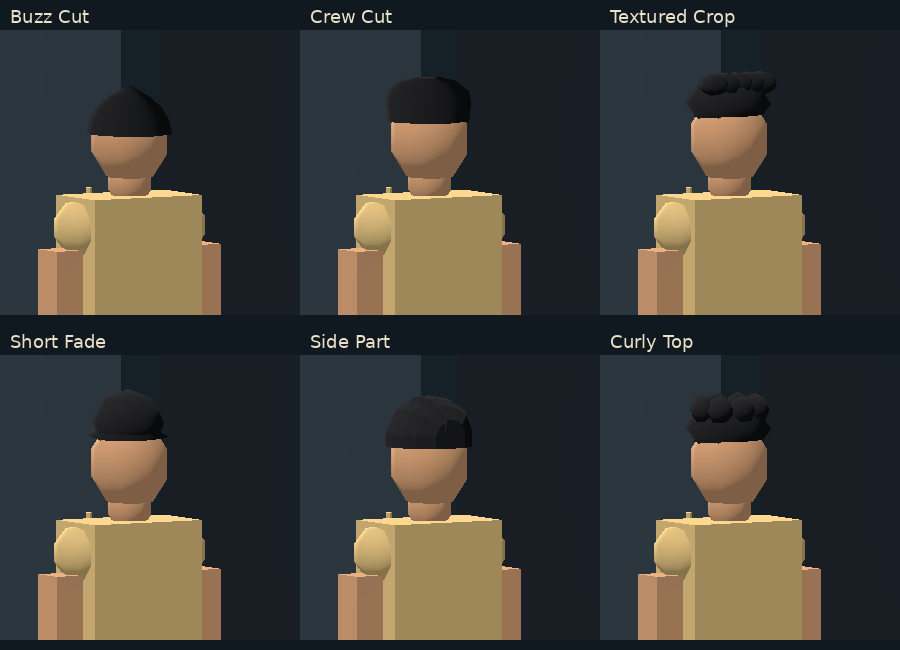
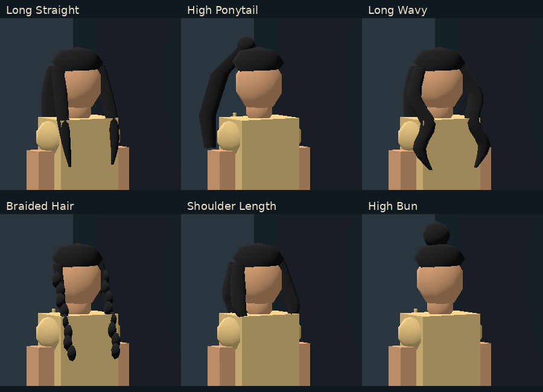

# v0.2.4.1 final hairstyle polish — visual approval pending

2026-11-10. Geometry-only follow-up to the uncommitted v0.2.4.1 review build. No commit, push, merge or deployment.

Only `scripts/customization/procedural_hair.gd` changes runtime behavior in this polish pass. Existing v0.2.4.1 work is preserved. Creator, category selection/session memory, appearance identifiers, body/face, static camera, Player Card, saves and UI files are byte-for-byte unchanged from the previous review build. Experimental GLBs are not used.

## Targeted changes

- **Buzz Cut (4):** close-fitting crown with a slightly deeper cross-section, closing the former scalp gaps. A convex-volume check finds all 27 upper scalp mesh vertices inside the hair coverage volume.
- **Crew Cut (5):** rounded, narrowing crown rings replace the broad rectangular top.
- **Side Part (8):** a single connected crown with an off-center recessed seam replaces the separate oval sections. Concave seam facets have correct face normals and backface winding.
- **Long Straight (10):** smoothly sampled low-poly drapes, changing thickness and tapered ends replace the rigid three-ring strips.
- **Long Wavy (12):** wider alternating S-curves and changing volume distinguish it from straight hair.
- **Shoulder Length (14):** shorter 0.26 m below-head extent (previously 0.30 m), a flared bob outline and inward-tucked ends.
- **Braided Hair (13):** more overlapping links around a continuous tapered core, including attachment beneath the cap and a continuous tail.

Mesh-array comparison confirms that Textured Crop (6), Short Fade (7), Curly Top (9), High Ponytail (11) and High Bun (15) remain exactly unchanged. All twelve names/IDs and four legacy identifiers retain their meanings.

## Real Godot/Chromium comparisons

All full captures use the same production camera, lighting, body and customization as before. Galleries are labeled crops of the actual 1920×1080 browser screenshots, not concept art or generated image replacements. The final Side Part capture follows its last connected-crown adjustment; the other eleven captures come from the full visual run.

Matched before/after crops: [three male changes](web-evidence/hairstyle-polish-0.2.4.1/male-before-after.png), [four female changes](web-evidence/hairstyle-polish-0.2.4.1/female-before-after.png).

| Style | Full current screenshot | Hair triangles |
|---|---|---:|
| Buzz Cut | [View](web-evidence/hairstyle-polish-0.2.4.1/male-buzz-cut.png) | 80 |
| Crew Cut | [View](web-evidence/hairstyle-polish-0.2.4.1/male-crew-cut.png) | 80 |
| Textured Crop | [View](web-evidence/hairstyle-polish-0.2.4.1/male-textured-crop.png) | 384 |
| Short Fade | [View](web-evidence/hairstyle-polish-0.2.4.1/male-short-fade.png) | 128 |
| Side Part | [View](web-evidence/hairstyle-polish-0.2.4.1/male-side-part.png) | 180 |
| Curly Top | [View](web-evidence/hairstyle-polish-0.2.4.1/male-curly-top.png) | 576 |
| Long Straight | [View](web-evidence/hairstyle-polish-0.2.4.1/female-long-straight.png) | 664 |
| High Ponytail | [View](web-evidence/hairstyle-polish-0.2.4.1/female-high-ponytail.png) | 192 |
| Long Wavy | [View](web-evidence/hairstyle-polish-0.2.4.1/female-long-wavy.png) | 784 |
| Braided Hair | [View](web-evidence/hairstyle-polish-0.2.4.1/female-braided-hair.png) | 1,368 |
| Shoulder Length | [View](web-evidence/hairstyle-polish-0.2.4.1/female-shoulder-length.png) | 664 |
| High Bun | [View](web-evidence/hairstyle-polish-0.2.4.1/female-high-bun.png) | 192 |

Selection remains unchanged: [male](web-evidence/hairstyle-polish-0.2.4.1/male-selection.png), [female](web-evidence/hairstyle-polish-0.2.4.1/female-selection.png). At 800×600: [Hair top](web-evidence/hairstyle-polish-0.2.4.1/hair-800-top.png), [scrolled bottom with accessible colors/navigation](web-evidence/hairstyle-polish-0.2.4.1/hair-800-bottom.png).

## Verification and limits

- All **521 native assertions pass**, including existing career creation, schemas 1/2/3, colors, category memories, Appearance/Identity/Player Card, save/reload, winding and maximum-body hairstyle framing checks.
- Official Godot **4.6.3.stable.official.7d41c59c4** Compatibility single-thread Web export succeeds without logged export warnings/errors.
- Real Chromium **156.0.8078.79**: 18 comparison/accessibility checks pass, plus a clean final Side Part capture/no-errors check. No recorded Godot/JavaScript/WebAssembly/network warnings/errors in either completed run. The earlier full flow/browser-persistence results remain documented in [the initial refinement report](STUDIO_REFINEMENT_VERIFICATION.md); this pass reruns native persistence and browser visual checks, not the entire browser save/restart sequence again.
- Geometry audit confirms only the requested seven meshes changed, five are identical, and all sampled upper-scalp vertices are covered. Protected-file SHA-256 checks confirm no creator/body/camera/Player Card/ID/schema changes.
- All hair remains one cached mesh/material surface per style. The maximum rises from 960 to 1,368 triangles for the connected braids; no textures, external assets, simulations, shaders or dependencies are added. No physical Windows 10/4 GB FPS claim is made.

[Raw results and audit](hairstyle_polish_verification.json). Visual acceptance remains the user's decision. Stop here and wait for approval before committing, pushing or deploying.
