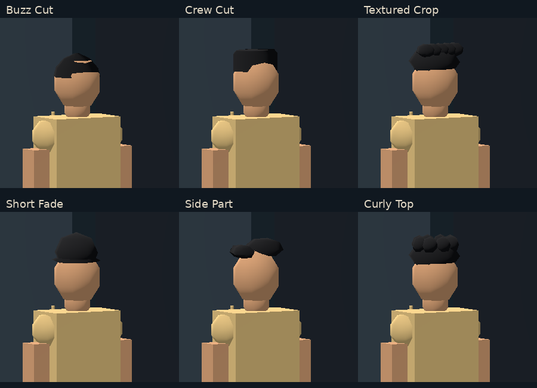
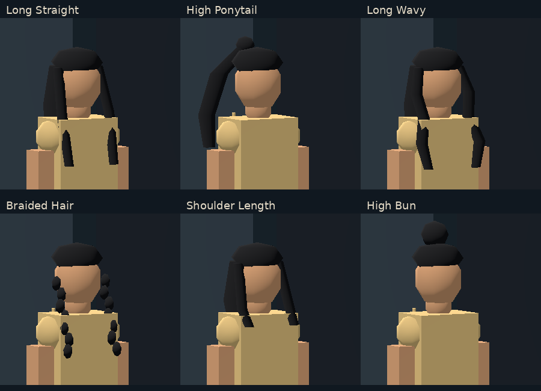

# Athlete Studio v0.2.4.1 — visual/test review pending

2026-11-10. Working checkout: `/workspace/work/github-checkout`, based on latest fetched main `17119be`. No commit, push, merge or deployment.

## Result and compatibility

Male selection initially displays Crew Cut; female selection initially displays Long Straight. Six relevant tiles are presented for each category, with separate category hairstyle memories during the editing session. Both remain explicitly selected categories; no category is inferred for legacy saves. All five colors, six skin tones and original body ranges remain available. Body proportions, fixed 230° preview orientation and camera are retained.

The original hairstyle IDs retain their exact labels and old primitive rendering: **0 Bald, 1 Cropped, 2 Short curls, 3 Ponytail**. New integer IDs are appended; no existing ID is repurposed and no save migration/write occurs on load. Schema 1/2/3, serialized keys, local path and overwrite confirmation remain unchanged. Older binaries cannot interpret the newly added IDs; their existing validation will reject those saves rather than silently changing them.

Height and weight now have exactly one editor each in Appearance Body. Identity retains first name, last name, country and derived starting age. Height/weight remain stored and displayed on the final card. Story's builder/content/logic and the **entire Player Card script** are unchanged. The twelve new meshes are procedural production hair only, with no experimental Blender/GLB assets.

## Actual tests

- Official Godot **4.6.3.stable.official.7d41c59c4**, Compatibility renderer; import and main-scene smoke checks pass.
- **521 native assertions pass:** 332 existing suites, 92 Studio assertions (the original hair loop now covers six instead of four choices), 97 focused refinement assertions. Coverage includes every new/old ID, category defaults/memory, shape/color updates, closed-face winding, maximum-body hair framing, Appearance-only numeric editors, exact card data, real local save/reload and unchanged orientation.
- **Chromium 156.0.8078.79**, real keyboard/mouse/canvas rendering with software SwiftShader: 35 core UI/gameplay/persistence assertions pass, followed by 14 clean legacy fixture checks and 18 final-render/accessibility checks in separate runs. These are **67 staged assertions**, not one uninterrupted clean run.
- The initial aggregate browser run passed its functionality checks but failed its final no-errors assertion because the obsolete localhost:8001 fixture server returned empty audio-worklet responses. That test server was restarted against this export. All schema 1/2/3 loads, original-byte/schema retention and the unselected legacy category then passed again without recorded runtime/network warnings/errors. Initial failed raw evidence is retained, not hidden.
- Final visual run captures the final geometry, including a closer-fitting Buzz Cut and a side-falling High Ponytail visible from the unchanged camera. Hair controls/colors remain accessible above navigation at 800×600; title and Hair/Skin/Body tabs remain pinned.
- Matching official 4.6.3 **single-thread Web release export succeeds**. An isolated packed-build check confirms version 0.2.4.1, production model present, and experimental directory/GLBs absent.

[Raw phase results, original fixture-server failure, geometry statistics and unchanged-contract hashes](studio_refinement_verification.json).

## Real Chromium screenshots

Selections: [Male / Crew Cut](web-evidence/studio-refinement-0.2.4.1/male-selection.png), [Female / Long Straight](web-evidence/studio-refinement-0.2.4.1/female-selection.png).

The galleries are labeled crops of the actual full Chromium screenshots at the same fixed camera and lighting. They are not concept art or generated renders. Full screenshots below show the selected tile and preview together.

| Category | Stored ID | Style / full screenshot | Hair triangles |
|---|---:|---|---:|
| Male | 4 | [Buzz Cut](web-evidence/studio-refinement-0.2.4.1/male-buzz-cut.png) | 64 |
| Male | 5 | [Crew Cut](web-evidence/studio-refinement-0.2.4.1/male-crew-cut.png) | 48 |
| Male | 6 | [Textured Crop](web-evidence/studio-refinement-0.2.4.1/male-textured-crop.png) | 384 |
| Male | 7 | [Short Fade](web-evidence/studio-refinement-0.2.4.1/male-short-fade.png) | 128 |
| Male | 8 | [Side Part](web-evidence/studio-refinement-0.2.4.1/male-side-part.png) | 128 |
| Male | 9 | [Curly Top](web-evidence/studio-refinement-0.2.4.1/male-curly-top.png) | 576 |
| Female | 10 | [Long Straight](web-evidence/studio-refinement-0.2.4.1/female-long-straight.png) | 208 |
| Female | 11 | [High Ponytail](web-evidence/studio-refinement-0.2.4.1/female-high-ponytail.png) | 192 |
| Female | 12 | [Long Wavy](web-evidence/studio-refinement-0.2.4.1/female-long-wavy.png) | 272 |
| Female | 13 | [Braided Hair](web-evidence/studio-refinement-0.2.4.1/female-braided-hair.png) | 960 |
| Female | 14 | [Shoulder Length](web-evidence/studio-refinement-0.2.4.1/female-shoulder-length.png) | 208 |
| Female | 15 | [High Bun](web-evidence/studio-refinement-0.2.4.1/female-high-bun.png) | 192 |

Identity: [1280×720](web-evidence/studio-refinement-0.2.4.1/identity-1280.png), [800×600](web-evidence/studio-refinement-0.2.4.1/identity-800.png).

Approved Player Card layout retained: [1280×720](web-evidence/studio-refinement-0.2.4.1/legacy-1280.png), [800×600 top](web-evidence/studio-refinement-0.2.4.1/legacy-top-800.png), [scrolled bottom](web-evidence/studio-refinement-0.2.4.1/legacy-bottom-800.png).

Additional: [unchanged Story](web-evidence/studio-refinement-0.2.4.1/story-unchanged.png), [Body controls](web-evidence/studio-refinement-0.2.4.1/appearance-body.png), [800×600 Hair top](web-evidence/studio-refinement-0.2.4.1/hair-800-top.png), [bottom showing final colors](web-evidence/studio-refinement-0.2.4.1/hair-800-bottom.png).

## Changes and performance limits

New: `scripts/data/hairstyle_catalog.gd`, `scripts/customization/procedural_hair.gd`, focused refinement tests, their UIDs, this report/raw results and screenshot evidence.

Updated: appearance enum bounds/labels; the existing model's hair-only integration; creator category mapping and removal of duplicate Identity editors; reusable choice-grid reconfiguration and category hair icons; version metadata; relevant regression expectations; README/design/technical/tasks/license notes. Player Card, Story implementation, body proportions, save repository/schema classes, gameplay, branding, loader and experimental branch are unchanged.

Hair geometry is **48–960 indexed triangles per style**, baked into one material surface and cached by ID. Color and body changes reuse immutable mesh resources; no frame-by-frame geometry, new textures, heavy shaders, external dependencies or services are introduced. No physical Windows 10/4 GB FPS/memory benchmark, other-browser testing, screen-reader testing or live deployment was performed. This remains a lightweight procedural style on the approved existing mannequin, not the unapproved GLB character milestone.

Stop here for visual and test approval. Do not commit, push, merge or deploy until authorized.
